<h1 align="center">MIKODES</h1>

  <b>Indie software studio. 2,000+ source codes sold.</b> 
  Ready-to-run apps, SaaS platforms and admin panels you can rebrand and sell as your own.

  <a href="https://mikodes.com"><b>mikodes.com</b></a> ·
  <a href="https://store.mikodes.com"><b>Store</b></a> ·
  <a href="https://mikodes.com/support"><b>Support</b></a> ·
  <a href="https://x.com/MikodesTeam"><b>X</b></a>

---

### Top 15 products

Each repository below is a showcase with screenshots, links and a real code excerpt.
The full source code of every product is available in the [MIKODES Store](https://store.mikodes.com): one payment, instant ZIP download, free setup help.

| | Product | What it is | |
|---|---|---|---|
|  | **SuperWallet** | Non-custodial multi-chain crypto wallet with admin panel (Flutter) | [Showcase](https://github.com/Mikodesteam/superwallet) · [Store](https://store.mikodes.com/p/superwallet/) |
| 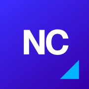 | **NFC Crypto Kit** | Crypto wallet where an NFC card confirms every signature | [Showcase](https://github.com/Mikodesteam/nfc-crypto-kit) · [Store](https://store.mikodes.com/p/nfccrypto/) |
| 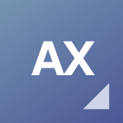 | **AXIS** | Perps terminal for on-chain futures trading (Flutter) | [Showcase](https://github.com/Mikodesteam/axis) · [Store](https://store.mikodes.com/p/axis/) |
| 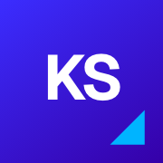 | **Kestrel** | Crypto trading bots: Flutter app + Node.js server | [Showcase](https://github.com/Mikodesteam/kestrel) · [Store](https://store.mikodes.com/p/kestrel/) |
| 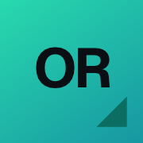 | **Outrider** | Memecoin research desk with paper and live trading | [Showcase](https://github.com/Mikodesteam/outrider) · [Store](https://store.mikodes.com/p/outrider/) |
| 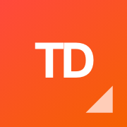 | **TIDE** | Self-custodial Solana wallet with a social feed | [Showcase](https://github.com/Mikodesteam/tide) · [Store](https://store.mikodes.com/p/tide/) |
| 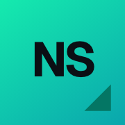 | **Nescroll** | Social browser without endless feeds (SwiftUI, iOS) | [Showcase](https://github.com/Mikodesteam/nescroll) · [Store](https://store.mikodes.com/p/nescroll/) |
| 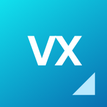 | **VOX** | AI voice assistant that calls you, with SaaS billing | [Showcase](https://github.com/Mikodesteam/vox) · [Store](https://store.mikodes.com/p/vox/) |
|  | **Kinetica** | AI motion-graphics video studio | [Store](https://store.mikodes.com/p/kinetica/) |
| 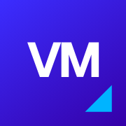 | **Vodmill** | AI video clipping platform with campaigns | [Store](https://store.mikodes.com/p/vodmill/) |
| 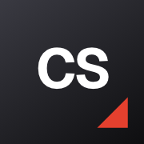 | **Channelsmith** | Documentary video studio for YouTube | [Showcase](https://github.com/Mikodesteam/channelsmith) · [Store](https://store.mikodes.com/p/channelsmith/) |
| 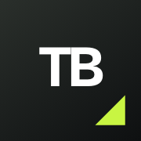 | **Truthbeam** | AI scam and fake-content checker | [Store](https://store.mikodes.com/p/truthbeam/) |
| 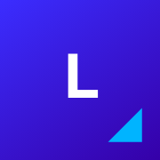 | **Leadlantern** | Local lead finder for agencies | [Store](https://store.mikodes.com/p/leadlantern/) |
| 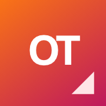 | **Omnithread** | Omnichannel team inbox for Perfex CRM | [Store](https://store.mikodes.com/p/omnithread/) |
| 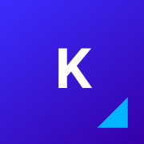 | **Kiln** | White-label AI website builder | [Store](https://store.mikodes.com/p/kiln/) |

### Open source

- [**LuckyWheel**](https://github.com/Mikodesteam/LuckyWheel): Android lucky-wheel custom view, MIT licensed.

### Custom work

Need a product built or rebranded for you? Write to us at [mikodes.com/support](https://mikodes.com/support).
